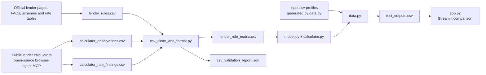

# Personal Loan Eligibility Model

A Python-based personal-loan comparison project built from public lender information. It brings research, evidence-labeled rules, repayment calculations, a deterministic eligibility waterfall, and a Streamlit results view into one reproducible workflow across 20 Indian lenders.

`screen_eligible` means that the profile passes the verified hard rules represented in the dataset. The model also reports conditional cases and rule-based estimates, so a reviewer can see how each comparison was reached.

## Contents

- [Project objective](#project-objective)
- [Lender selection](#lender-selection)
- [Research method and source verification](#research-method-and-source-verification)
- [Repository architecture](#repository-architecture)
- [Applicant inputs](#applicant-inputs)
- [Rule data and standardization](#rule-data-and-standardization)
- [Financial calculations](#financial-calculations)
- [Eligibility and lender comparison](#eligibility-and-lender-comparison)
- [Setup and use](#setup-and-use)
- [Sample scenarios, checks, and insights](#sample-scenarios-checks-and-insights)

## Project objective

The project addresses a practical question: given an applicant's profile, which personal-loan lenders appear to fit the published eligibility rules, and how do their estimated amounts, rates, and tenures compare?

Personal-loan criteria are distributed across eligibility pages, scheme documents, FAQs, rate tables, and public calculators. This project structures that material as lender-level datapoints with provenance and evidence status. The model applies the datapoints to a supplied profile, explains rule outcomes, estimates affordability when the required parameters are available, and ranks potential lender options.

The scope is personal loans in India. Profiles used for the included scenarios are synthetic. The app provides a simple browser for the saved scenarios; the model also exposes a Python API for evaluating a caller-supplied profile.

## Lender selection

The 20 lenders were chosen in two stages. The first stage asked which lenders matter in the personal-loan market. The second asked which of them can be modelled honestly from public sources. The result is a coverage-based comparison set, not a market-share ranking.

### Stage 1: shortlist of 30 candidates

Candidates were drawn from four institution types: public-sector banks, private banks, small finance banks, and NBFC or fintech-linked lenders. A lender entered the shortlist only if it met both conditions:

- **Market presence:** it is an established, widely available provider of retail lending in India, so a typical applicant could realistically approach it.
- **Product availability:** it offers an unsecured personal loan to individuals and describes that product publicly. A lender with only a lead-capture form and no published criteria did not qualify.

### Stage 2: cut to 20 by verifiable rules

Each shortlisted lender was then researched using official product pages, FAQs, scheme documents, rate tables, and public calculators. Candidates were ranked by how many eligibility, amount, rate, and tenure rules could be confirmed from official public sources (`VERIFIED_OFFICIAL` rows). Lenders with few verifiable rules were dropped in favour of lenders with more. This keeps the model from resting mostly on estimates.

The same test settled the close calls. For example, among SMFG India Credit, L&T Finance, and Piramal Finance, the two with the most verified rules were kept. Candidates that were shortlisted but not retained include Ujjivan Small Finance Bank, Suryoday Small Finance Bank, Piramal Finance, Aditya Birla Capital, and Moneyview.

### Final set and the type split

| Institution type        | Lenders                                                                                                                                 |
| ----------------------- | --------------------------------------------------------------------------------------------------------------------------------------- |
| Public-sector banks (7) | State Bank of India, Bank of Baroda, Union Bank of India, Central Bank of India, Bank of Maharashtra, Punjab National Bank, Canara Bank |
| Private banks (5)       | HDFC Bank, ICICI Bank, Axis Bank, Kotak Mahindra Bank, IDFC FIRST Bank                                                                  |
| Small finance banks (3) | AU Small Finance Bank, Equitas Small Finance Bank, ESAF Small Finance Bank                                                              |
| NBFCs (5)               | Bajaj Finance, Tata Capital, Poonawalla Fincorp, SMFG India Credit, L&T Finance                                                         |

The split is not an equal quota. The plan started at five lenders per type, and the second-stage cut moved the counts:

- **Public-sector banks (7):** these publish the most detailed and standardized scheme documents, with explicit age, income, FOIR, and income-multiple rules and published rate tables. More of them cleared the verifiable-rule cut, so they hold the most slots.
- **Private banks (5):** major retail personal-loan providers with dedicated eligibility pages and calculators.
- **Small finance banks (3):** fewer of them publish personal-loan criteria in enough detail, so only three cleared the cut.
- **NBFCs (5):** the leading non-bank personal-loan lenders. Their rules are less fully published, so calculator probing carries more weight for them.

### Effect on the results

Because the cut favours lenders with more published rules, the set leans toward transparent lenders. Lenders that publish little are under-represented, and they may behave differently from the ones modelled here. Insights from this project describe the 20 lenders in the set and should not be read as statements about the whole market.

## Research method and source verification

Calculator research began with an open-source AI browser-agent MCP server. It was used to interact with public lender calculators and record test inputs, visible outputs, calculator URLs, test IDs, and access dates. These observations are preserved as calculator evidence, separately from lender-published eligibility rules.

The broader research reviewed official lender product and eligibility pages, FAQs, scheme/product terms, and published rate tables. Claude with Firecrawl, Perplexity web search, and Gemini web search supported source discovery and cross-checking. Public calculator results were compared with the corresponding product material and retained with evidence labels that distinguish direct observations, inferences, inconclusive results, and undisclosed behavior.

Each rule row can retain its source URL, publisher and source type, access date, supporting passage, applicable segment, evidence status, confidence, and estimation or conflict notes. Recorded lender-rule access dates are **2026-10-11** and **2026-10-12**. The current lender-rule CSV contains **486 rows and 40 distinct non-empty source URLs**. Representative sources include:

- [SBI personal-loan page](https://sbi.bank.in/web/personal-banking/loans/personal-loans/sbi-personal-loan)
- [Bank of Baroda personal-loan page](https://bankofbaroda.bank.in/loans/personal-loan/baroda-personal-loan)
- [ICICI personal-loan eligibility page](https://www.icici.bank.in/personal-banking/loans/personal-loan/eligibility)
- [PNB personal-loan scheme](https://pnb.bank.in/personalloanforpublic.html)
- [PNB interest-rate table](https://www.pnb.bank.in/interst-rate-on-advances-linked-to-mclr.html)

Evidence classifications keep source strength visible instead of collapsing every datapoint into a single "rule" field:

| Status                              | Interpretation in the project                                                                                                   |
| ----------------------------------- | ------------------------------------------------------------------------------------------------------------------------------- |
| `VERIFIED_OFFICIAL`                 | Numeric or textual value recorded as supported by an official lender source; eligible for default hard-rule enforcement.        |
| `OFFICIAL_PARTIAL`                  | Official material supports part of the rule or provides incomplete detail.                                                      |
| `ESTIMATE_PEER`, `ESTIMATE_DERIVED` | Peer-based or derived estimate, retained with its method and context.                                                           |
| `THIRD_PARTY_UNVERIFIED`            | Public third-party information without an official lender confirmation in the dataset.                                          |
| `CONFLICT_RESOLVED`                 | Conflicting evidence preserved with a recorded resolution.                                                                      |
| `NOT_PUBLISHED`, `NOT_APPLICABLE`   | Explicit dataset markers for a value not located in the reviewed public materials or a rule that does not apply to the segment. |

## Repository architecture

The components follow a research-to-result pipeline. The source datasets remain distinct until the cleaner standardizes their schema and creates the matrix consumed by the model.



| File                           | Role                                                                                                                                     |
| ------------------------------ | ---------------------------------------------------------------------------------------------------------------------------------------- |
| `lender_rules.csv`             | Original lender-rule research table with source fields and evidence status.                                                              |
| `calculator_observations.csv`  | Scenario-level input/output records from public lender calculators.                                                                      |
| `calculator_rule_findings.csv` | Summarized calculator findings, evidence labels, and suggested model handling.                                                           |
| `csv_clean_and_format.py`      | Validates source schemas, reconciles lender IDs, preserves every input record, and writes the standardized matrix and validation report. |
| `lender_rule_matrix.csv`       | Unified long-format dataset used by the model. `record_type` distinguishes rules, calculator observations, and calculator findings.      |
| `csv_validation_report.json`   | Row reconciliation, source-file hashes, and data-quality validation results.                                                             |
| `calculator.py`                | Reusable, lender-agnostic EMI, principal, FOIR, income-multiple, loan-limit, and scenario calculations.                                  |
| `model.py`                     | Segment matching, eligibility waterfall, amount and rate estimates, scorecard, lender ranking, and evidence output.                      |
| `data.py`                      | Defines 15 synthetic profiles and writes `input.csv` plus model assessments in `test_outputs.csv`.                                       |
| `input.csv`                    | Generated applicant scenario inputs.                                                                                                     |
| `test_outputs.csv`             | Saved overall and lender-level model results for the sample profiles.                                                                    |
| `app.py`                       | Streamlit view of a selected saved profile and its lender options.                                                                       |

The cleaner's current validation report records all **593** source records in the matrix (486 lender rules, 86 calculator observations, and 21 calculator findings), unchanged input-source hashes, 20 mapped lender IDs, and no reported duplicate rule IDs, invalid rule numbers, invalid dates, or inconsistent minimum/maximum pairs. Empty source values remain empty rather than being interpreted as zero.

## Applicant inputs

`model.evaluate(profile)` accepts a Python dictionary with the following fields. In the sample data, these are synthetic scenario values; a real application would obtain the profile from applicant input and supporting documents. A credit score would come from a bureau report with the applicant's authorization.

| Variable                  | Type and unit                           | Purpose                                                                   | Real-world source                                     |
| ------------------------- | --------------------------------------- | ------------------------------------------------------------------------- | ----------------------------------------------------- |
| `age`                     | Number, years                           | Application-age and maturity-age checks.                                  | Applicant; KYC document                               |
| `employment_type`         | Category: `salaried` or `self_employed` | Chooses employment-specific rules.                                        | Applicant; employment or business records             |
| `monthly_net_income`      | Number, INR/month                       | Income floors, FOIR where net basis applies, and scorecard.               | Applicant; payslip, bank statement, or income records |
| `monthly_gross_income`    | Number, INR/month                       | FOIR or multiple basis when the applicable source specifies gross income. | Applicant; payslip or income records                  |
| `existing_monthly_emi`    | Number, INR/month                       | Current debt obligations for FOIR capacity and debt scoring.              | Applicant; bureau report and statements               |
| `credit_score`            | Number or blank, bureau points          | Score-floor check and indicative rate tier.                               | Credit bureau report, with authorization              |
| `current_job_months`      | Number, months                          | Current-job tenure check and stability score.                             | Applicant; employer records                           |
| `total_experience_months` | Number, months                          | Total work-experience check and stability score.                          | Applicant; employment history                         |
| `business_vintage_months` | Number, months                          | Business tenure for self-employed scenarios.                              | Applicant; business/tax records                       |
| `requested_amount`        | Number, INR                             | Product-limit check and amount-fit score.                                 | Applicant                                             |
| `requested_tenure_months` | Integer, months                         | Product tenure check and affordability calculation.                       | Applicant                                             |
| `employer_category`       | Text category                           | Employer segment matching, where represented in lender rules.             | Applicant; employer documentation                     |
| `salary_account_lender`   | Text                                    | Salary-account segment matching, where represented.                       | Applicant; bank statement                             |
| `city_type`               | Text category                           | Location-segment matching, where represented.                             | Applicant; address/KYC record                         |

`profile_id` and `edge_case` in `input.csv` identify and describe the sample scenarios; they are not lender-rule inputs. The model validates supplied numeric values and carries omitted information into conditional results where it is needed for a rule check.

## Rule data and standardization

The source tables use different structures and vocabularies. `csv_clean_and_format.py` maps their fields into a consistent long-format schema while retaining the original row context. A lender rule remains one matrix record per sourced observation; multiple products, segments, and values are preserved as separate records rather than flattened into a single lender-wide threshold.

The standardized matrix includes record type, source file and row, lender identity and class, rule key, segment, value and unit, evidence status, source URL and publisher, access date, supporting passage, and raw source JSON. Calculator records use distinct `calculator_observation` and `calculator_finding` record types, so they remain traceable research evidence and are not mistaken for lender rules.

The current 486 lender-rule rows have these recorded statuses:

| Evidence status          | Rows |
| ------------------------ | ---- |
| `VERIFIED_OFFICIAL`      | 210  |
| `OFFICIAL_PARTIAL`       | 34   |
| `ESTIMATE_PEER`          | 217  |
| `ESTIMATE_DERIVED`       | 7    |
| `THIRD_PARTY_UNVERIFIED` | 6    |
| `CONFLICT_RESOLVED`      | 1    |
| `NOT_PUBLISHED`          | 3    |
| `NOT_APPLICABLE`         | 8    |

By default, `VERIFIED_OFFICIAL` values can create hard eligibility rejections. Official partial, estimated, and third-party values remain visible in evidence and may inform clearly marked capacity or pricing estimates. Where an uncertain rule conflicts with an applicant value, the model can return `conditional`. `evaluate(profile, include_estimates=True)` opts supported partial and estimated records into hard enforcement while retaining their original evidence status.

## Financial calculations

`calculator.py` contains generic financial formulas. It receives lender-specific FOIR percentages, rates, multiples, amounts, and terms from the model; it does not assign universal lender parameters.

### Monthly reducing-balance EMI

For principal `P`, annual interest rate `R` expressed as a percentage, and term `n` months, the monthly periodic rate is `r = R / 1200`. For a positive rate:

```
EMI = P × r × (1 + r)^n / ((1 + r)^n − 1)
```

At zero interest:

```
EMI = P / n
```

### Principal supported by a monthly payment

For monthly payment `E`, periodic rate `r`, and term `n`:

```
P = E × (1 − (1 + r)^(-n)) / r       when r > 0
P = E × n                             when r = 0
```

### FOIR-derived payment room and principal

For income basis `I`, maximum FOIR `F` in percentage points, and existing monthly EMI `X`, available EMI capacity is:

```
E_available = max(0, I × F / 100 − X)
```

The model converts this payment capacity to a principal using the available lender `rate_max` and requested tenure. Income is gross only where the applicable FOIR source indicates a gross-income basis; otherwise the model uses net monthly income. If an input required by the calculation is unknown, the FOIR principal calculation returns no numeric estimate.

### Income multiple and combined amount capacity

When a lender rule supplies an income multiple `M`:

```
P_multiple = applicable monthly income basis × M
```

The model compares available product maximum, income-multiple cap, and FOIR-derived principal cap, then uses the smallest available numeric cap for its modelled capacity. A product maximum from the lender source is also returned separately as `published_product_max_loan_amount`.

### Indicative score-tier rate

When credit score and a rate range are available, the model maps the score band to a fraction `q` of the recorded range:

```
estimated_rate = rate_min + (rate_max − rate_min) × q
```

| Score band | `q`  |
| ---------- | ---- |
| 800+       | 0.10 |
| 750–799    | 0.25 |
| 700–749    | 0.55 |
| 650–699    | 0.85 |
| Below 650  | 1.00 |

This is a transparent project estimate within the available rate range. Where a lender-specific CIBIL rate-band table exists, it remains in the evidence matrix; the current interpolation uses the common project score bands.

## Eligibility and lender comparison

`model.py` loads `lender_rule_matrix.csv` by default, groups lender-rule rows by lender ID, and evaluates each lender against the profile. Calculator observation and finding records are attached as research evidence, not enforcement rules. The model retains its earlier `lender_rules.csv` loading path for compatibility.

### Waterfall

The lender-level waterfall follows these stages:

1. **Match applicant and product segment:** employment type, employer category, salary-account bank, income, and location are matched against recognized segment text.
2. **Check eligibility gates:** self-employment eligibility and business vintage, age and age at maturity, income floor, credit-score floor, current-job tenure, and total experience.
3. **Check requested terms:** product minimum/maximum amount and minimum/maximum tenure where recorded.
4. **Calculate affordability:** derive FOIR payment room and/or an income-multiple cap when the applicable rule and profile inputs support it.
5. **Estimate terms:** estimate rate tier and requested-loan EMI where rate, score, amount, and tenure are available.
6. **Return result with reasons and evidence:** attach rule statuses, source URLs, access dates, unknown items, scorecard components, and calculator evidence examples.

The model labels lender outcomes as `screen_eligible`, `conditional`, or `not_eligible`. Its 100-point scorecard ranks profiles across five transparent dimensions:

| Component                        | Model scoring                                                                                                  |
| -------------------------------- | -------------------------------------------------------------------------------------------------------------- |
| Credit score (30 points)         | 30 at 800+, 26 at 750–799, 19 at 700–749, 10 at 650–699, otherwise 0.                                          |
| Income headroom (25 points)      | 25 at 2× income floor, 20 at 1.5×, 14 at the floor, otherwise 0; uses ₹25,000/month when no floor is recorded. |
| Employment stability (20 points) | 20 for job ≥36 months and experience ≥60; 16 for job ≥12 and experience ≥24; 10 for job ≥6; otherwise 0.       |
| Existing debt burden (15 points) | 15 at existing EMI/net income ≤10%, 12 at ≤25%, 8 at ≤40%, otherwise 0.                                        |
| Requested amount fit (10 points) | 10 when calculated capacity is known and covers the requested amount.                                          |

The model API's `best_option` prioritizes screen-eligible lenders, then score and estimated rate; conditional options follow. In `app.py`, the displayed top match is the screen-eligible option with the lowest estimated rate, with a conditional option shown when no screen-eligible option is present. This makes the API ranking and the app's price-first comparison intentionally interpretable as different views of the same lender results.

## Setup and use

Run commands from the folder containing `app.py` and `model.py`. Python 3.10 or later is recommended. Install the app dependencies:

```
python -m pip install streamlit pandas
```

Regenerate the standardized lender matrix and validation report from the three research CSVs, then generate the sample profiles and saved assessments:

```
python csv_clean_and_format.py
python data.py
```

Run the Streamlit app:

```
python -m streamlit run app.py
```

The model can also evaluate a custom dictionary directly:

```python
from model import evaluate

profile = {
    "age": 32,
    "employment_type": "salaried",
    "monthly_net_income": 80000,
    "monthly_gross_income": 95000,
    "existing_monthly_emi": 10000,
    "credit_score": 760,
    "current_job_months": 36,
    "total_experience_months": 72,
    "business_vintage_months": 0,
    "requested_amount": 800000,
    "requested_tenure_months": 48,
    "employer_category": "private",
    "salary_account_lender": "",
    "city_type": "metro",
}

result = evaluate(profile)
print(result["overall_decision"])
print(result["best_option"])
```

For command-line use, save a profile with the same keys in JSON and run `python model.py profile.json`. To enforce eligible partial and estimated numeric records as constraints, use `evaluate(profile, include_estimates=True)` or add `--include-estimates` to the CLI command.

## Sample scenarios, checks, and insights

`data.py` defines **15 synthetic profiles**: ten edge cases (recently salaried, no supplied CIBIL score, young applicant with high EMI, low income with high EMI, self-employed with short business vintage, near an age limit, low score, large loan request, and high EMI burden) plus five standard salaried cases. `input.csv` stores the profiles; `test_outputs.csv` stores the model result for each profile and lender.

### Recorded sample results

The current saved outputs cover **300 lender-profile assessments** (15 profiles × 20 lender rows):

| Result level      | Recorded outcome                   | Count |
| ----------------- | ---------------------------------- | ----- |
| Profile summary   | `eligible_for_at_least_one_lender` | 11    |
| Profile summary   | `conditional_or_no_match`          | 3     |
| Profile summary   | `insufficient_profile_data`        | 1     |
| Lender assessment | `screen_eligible`                  | 109   |
| Lender assessment | `conditional`                      | 102   |
| Lender assessment | `not_eligible`                     | 89    |

These figures are counts from the saved synthetic scenarios and the current rule matrix. They demonstrate how the waterfall behaves across varied profiles; they are not a measure of real-world approvals.

### Research and implementation findings

- The lender matrix holds **210 `VERIFIED_OFFICIAL` rows** alongside **217 `ESTIMATE_PEER`** and **34 `OFFICIAL_PARTIAL`** rows. This mix makes evidence status central to the design: estimates can support marked comparisons while verified rules drive default hard checks.
- Calculator research produced **86 observations and 21 summarized findings**. Keeping these in separate record types allows the model to expose calculator behavior without promoting it to lender underwriting policy.
- The 15 scenarios yield a spread of `screen_eligible`, `conditional`, and `not_eligible` lender outcomes. In particular, the no-score profile receives an `insufficient_profile_data` overall label, while per-lender rows preserve the more detailed result.
- Across the generated profiles, the model's `best_option` labels include Equitas Small Finance Bank four times, HDFC Bank three times, and SBI twice. These are rankings for the constructed examples under this dataset, not a lender quality ranking.
- The development validation run reported **14 unit tests passed**. The checks cover EMI/principal arithmetic, FOIR and income-multiple calculations, input validation, source-row preservation, evidence separation, legacy CSV compatibility, lender-specific capacity/rate behavior, and conditional/estimated-rule handling.

Together, these results show how evidence classification and explainable rules can make a lender comparison reviewable: a result is accompanied by its matching criteria, calculated caps, rate assumptions, and source trail rather than a single opaque score.
### Calculator evidence

Calculator findings are advisory only. Of the 20 lenders, only Kotak Mahindra Bank and IDFC FIRST Bank had a public calculator whose maximum-amount answers fit one consistent multiple of disposable income (about 20× and 10×, across 7 observations each). The model returns this as `calculator_reference` with an indicative amount. It is never used for eligibility, capacity, ranking or the best option. The other calculators were EMI-only, blank or inconclusive, so they are kept as evidence and not used for sizing.

## Limits of the model

- **No approval data.** `screen_eligible` means a profile passes the verified rules in the dataset. It does not mean a lender will approve it.
- **Many rules are estimates.** 217 of 486 rule rows are peer estimates. By default they do not cause rejections, so many lender results come back `conditional` instead of a firm yes or no. `include_estimates=True` applies them as constraints.
- **Rates are interpolated.** The expected rate is placed within each lender's published range using common score bands (800+, 750–799, and so on). Lenders do not publish this mapping, and the scorecard weights are my own judgement.
- **Not modelled:** missed payments (DPD), recent credit enquiries, write-offs and settled loans, employer-specific pricing, processing fees and GST in the ranking, and city-based income floors.
- **Lender set is biased toward transparent lenders.** The final cut favoured lenders that publish more rules, so the insights describe these 20 lenders, not the whole market.
- **Test profiles are synthetic.** The 15 profiles show how the rules behave. They say nothing about real approval rates.
- **Rules change.** Every value carries the date it was read (2026-10-11 and 2026-10-12).

## What I would add next

1. Add bureau inputs: missed payments, enquiries and write-off flags.
2. Rank by APR or total cost including fees and GST, not by rate alone, and use one definition of "best option".
3. Turn more calculator findings into sizing rules as more lenders expose usable calculators.
4. Add a breakdown of which rule rejects the most applicants, and a what-if view, for example how many lenders open up with +50 score points.
5. Replace peer estimates with official values wherever a source can be found.
6. Add a unit-test file to the repo.
